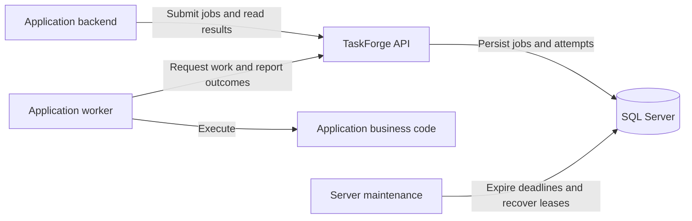

# TaskForge

[](https://github.com/Arvence/TaskForge/actions/workflows/ci.yml)

TaskForge is an HTTP job orchestration server built with .NET and SQL Server.
Applications submit background work, execute it in their own processes, and query
its progress. TaskForge stores jobs and attempt history, assigns work to compatible
clients, and manages retries, deadlines, and cancellation.

Use it to move work such as report generation or service requests out of an HTTP
request while keeping a durable record of what happened. Business code stays in
the application that owns it. Any language can integrate through HTTP; the .NET
SDK provides a client, typed handlers, and a hosted worker.

## Try TaskForge with Postman

The [Postman collection](postman/TaskForge.postman_collection.json) includes API
requests, saved response examples, and feature tests. You need Postman and the
running API/database; no SDK or sample worker is required for these tests.

1. Follow [Start the server](#start-the-server) to clone the repository and run
   `./setup.ps1`. Confirm [readiness](http://localhost:8275/api/ready) returns `Ready`.
2. In Postman, select **Import** and choose
   `postman/TaskForge.postman_collection.json` from your local checkout.
3. Set the local `applicationId` and `apiKey` variables from your
   [test application configuration](docs/payload-contracts.md). Set the request
   timeout to **30,000 ms** for the automatic retry scenario. Application Routing
   also needs `otherApplicationId` and `otherApiKey` for a second test application.
4. Open **02 — Feature Tests**, choose one scenario folder, and select **Run folder**.
   Run its requests in the displayed order with **one iteration** and **no added
   delay**, then review the assertions in the test results.

Try the seven scenarios: priority scheduling, idempotency, automatic retry,
cancellation and replay, attempt ownership, application routing, and validation.
Expected error responses are part of the negative tests.

**Run one scenario folder at a time; do not run the entire collection at once.**
Run each scenario against a dedicated test application with an empty queue.
The scenarios create test jobs and report simulated worker outcomes.
Postman does not execute business handlers. Use **01 — API Explorer** to send
individual requests; **03 — Advanced Verification** contains inspection requests.
Concurrency, timeout recovery, and worker crash behavior are covered by the
[integration tests](#build-and-test).

## How it works



Workers request jobs for an application ID and a set of supported types. Each
assignment includes a job ID, attempt ID, worker ID, payload, and fixed deadline.
The worker executes its local handler and reports success or failure. TaskForge
never invokes application callbacks or runs business handlers inside the API.

- **Durable execution records:** jobs, results, errors, and individual attempts.
- **Controlled distribution:** application/type routing, priorities, and atomic acquisition.
- **Recovery:** capped retry backoff, timeout handling, dead-lettering, and manual replay.
- **Safe reporting:** duplicate acknowledgments and rejection of stale or conflicting outcomes.
- **Client integration:** plain HTTP, an independent .NET SDK, and a runnable sample client.

See [architecture and job lifecycle](docs/architecture.md) for execution semantics
and project dependencies.

## Run locally

Requires Git, a stable **.NET 10 SDK**, Docker with Compose v2 and Linux containers,
and PowerShell. Use Windows PowerShell 5.1 or PowerShell 7; on Linux, use PowerShell 7.
The server runs in Docker. The sample worker runs on your host.

### Start the server

```powershell
git clone https://github.com/Arvence/TaskForge.git
cd TaskForge
Copy-Item .taskforge-apps.env.example .taskforge-apps.env
```

Replace the API key placeholder in `.taskforge-apps.env` with a unique key.
See [application access and payload validation](docs/payload-contracts.md) for
the key requirements. Then run setup from the repository root:

```powershell
./setup.ps1
```

Setup checks Docker, creates `.env` when needed, and prompts for a SQL Server
password. Accept `Start TaskForge now? [Y/n]` to build and start the services.
It waits for database connectivity at [http://localhost:8275/api/ready](http://localhost:8275/api/ready).
Existing configuration and database data are preserved.

If Windows blocks the script, run
`powershell -NoProfile -ExecutionPolicy Bypass -File ./setup.ps1`.
For direct Compose setup without PowerShell, see [server configuration](docs/architecture.md#server-configuration).

### Start the optional sample worker

From the repository root, in the first terminal:

```powershell
dotnet build TaskForge.sln --configuration Release
$env:TaskForge__BaseUrl = 'http://localhost:8275'
$env:TaskForge__ApplicationId = 'a-project'
$env:TaskForge__ApiKey = '<SAMPLE_APPLICATION_API_KEY>'
$env:TaskForge__Worker__SlotCount = '5'
dotnet run --project samples/TaskForge.SampleClient --configuration Release --no-build -- run --general
```

Leave this terminal open. The sample worker uses up to five slots for `general`
jobs and selects the report or HTTP GET handler from `payload.operation`. Jobs
wait for a worker that advertises their type.

### Submit a report and inspect the result

In a second PowerShell terminal, from the repository root:

```powershell
$env:TaskForge__BaseUrl = 'http://localhost:8275'
$env:TaskForge__ApplicationId = 'a-project'
$env:TaskForge__ApiKey = '<SAMPLE_APPLICATION_API_KEY>'
$submitted = dotnet run --project src/TaskForge.Cli --configuration Release --no-build -- submit samples/TaskForge.SampleClient/payloads/report.json | ConvertFrom-Json
if ($LASTEXITCODE -ne 0) { throw 'Report submission failed.' }

$api = $env:TaskForge__BaseUrl
$headers = @{ Authorization = "Bearer $env:TaskForge__ApiKey" }
$deadline = [DateTimeOffset]::UtcNow.AddSeconds(30)
do {
    $job = Invoke-RestMethod "$api/api/jobs/$($submitted.id)" -Headers $headers
    if ($job.status -in @('Completed', 'DeadLettered', 'Cancelled')) { break }
    Start-Sleep -Milliseconds 250
} while ([DateTimeOffset]::UtcNow -lt $deadline)
if ($job.status -ne 'Completed') { throw "Expected Completed; got $($job.status)." }

$job.result | ConvertTo-Json -Depth 5
$attempts = Invoke-RestMethod "$api/api/jobs/$($job.id)/attempts" -Headers $headers
$attempts | Format-Table attemptNumber, outcome, workerId, durationMilliseconds -AutoSize
```

The report has three entries totaling **190.25**, grouped into Supplies (**40.25**)
and Travel (**150.00**). The first attempt is `Succeeded`, with `retryCount: 0`.
The sample guide covers [custom reports, HTTP jobs, and multiple clients](docs/dotnet-client.md#sample-client).

Stop the worker with Ctrl+C. Stop the server with `docker compose down`; the SQL
named volume retains your jobs. Adding `--volumes` deletes that data.

## Integrate with an application

| Integration | What to use |
| --- | --- |
| .NET | [Local NuGet package](#use-the-local-net-sdk-package) or [SDK project and hosted worker](docs/dotnet-client.md). |
| Node.js, Python, or another language | [HTTP API](docs/http-api.md): submit, acquire, execute locally, and report. No callback endpoint is required. |
| Postman | Import the [collection](postman/TaskForge.postman_collection.json) and follow the [tryout instructions](#try-taskforge-with-postman). |
| Another API client | Import the running server's [OpenAPI document](http://localhost:8275/openapi/v1.json). |
| Local inspection | [Read-only console](docs/dotnet-client.md#debugging-console) for health, statistics, and job lists. |

The application decides when to submit work. TaskForge schedules retries of
submitted jobs; it does not schedule recurring application tasks. Workers can run
inside a backend service or as separate processes.

## Use the local .NET SDK package

### Build the package

Run from the TaskForge repository root with the .NET 10 SDK:

```powershell
dotnet pack src/TaskForge.SDK/TaskForge.SDK.csproj -c Release -o artifacts/nuget
$feed = (Resolve-Path artifacts/nuget).Path
```

This creates `artifacts/nuget/TaskForge.SDK.2.0.0.nupkg` for `net10.0` using the
version in `Directory.Build.props`. The output is ignored by Git. The package is
for local installation and stays in the folder feed.

### Install in another .NET 10 project

In the same PowerShell session, switch to a directory outside the TaskForge
repository. For a new consumer, create the project there:

```powershell
dotnet new console --framework net10.0 --no-restore
```

Create a `NuGet.Config` next to the consumer's project file. If the project
already has one, merge these sources and mappings into it.

```powershell
$localSource = [System.Security.SecurityElement]::Escape($feed)
@"
<configuration>
  <packageSources>
    <clear />
    <add key="TaskForgeLocal" value="$localSource" />
    <add key="nuget.org" value="https://api.nuget.org/v3/index.json" />
  </packageSources>
  <packageSourceMapping>
    <packageSource key="TaskForgeLocal">
      <package pattern="TaskForge.SDK" />
    </packageSource>
    <packageSource key="nuget.org">
      <package pattern="*" />
    </packageSource>
  </packageSourceMapping>
</configuration>
"@ | Set-Content -Encoding UTF8 NuGet.Config
```

Add the package reference and restore. The exact ID maps to the local folder,
while NuGet.org supplies third-party dependencies. The restore uses a
project-specific package cache under `obj`.

```powershell
dotnet package add TaskForge.SDK --version 2.0.0 --no-restore
dotnet restore --configfile ./NuGet.Config --packages ./obj/nuget-packages
dotnet build -c Release --no-restore
```

### Submit a job with the package

For a smoke check, [start TaskForge](#start-the-server) and provision the sample
application key. Replace the consumer's `Program.cs` with this example:

```csharp
using System.Text.Json;
using TaskForge.SDK;
using TaskForge.SDK.Jobs;

using HttpClient http = new();
TaskForgeClient client = new(http, new()
{
    BaseUrl = new Uri(Environment.GetEnvironmentVariable("TaskForge__BaseUrl") ?? "http://localhost:8275"),
    ApplicationId = "a-project",
    ApiKey = Environment.GetEnvironmentVariable("TaskForge__ApiKey")
});

JsonElement payload = JsonSerializer.SerializeToElement(new
{
    operation = "generate-report",
    title = "Office expenses",
    entries = new[] { new { category = "Supplies", amount = 12.50m } }
});

JobResponse job = await client.SubmitAsync(new SubmitJobRequest(payload));
Console.WriteLine($"{job.Id} {job.Type} {job.Status}");
```

```powershell
$env:TaskForge__ApiKey = '<SAMPLE_APPLICATION_API_KEY>'
dotnet run -c Release --no-restore
```

Expect a job ID and `general Queued`. Submission alone requires the API and
database. Start the [sample worker](#start-the-optional-sample-worker) to execute
the report.

### Install an updated local build

Use a new package version so NuGet picks up the rebuilt SDK. For example, from the
TaskForge root:

```powershell
dotnet pack src/TaskForge.SDK/TaskForge.SDK.csproj -c Release -o artifacts/nuget -p:PackageVersion=2.0.1-local.1
```

From the consumer directory, with the same `NuGet.Config`:

```powershell
dotnet package add TaskForge.SDK --version 2.0.1-local.1 --no-restore
dotnet restore --configfile ./NuGet.Config --packages ./obj/nuget-packages
dotnet build -c Release --no-restore
```

Use the next version, such as `2.0.1-local.2`, on subsequent rebuilds.

## Execution and deployment boundaries

- **Application access:** job operations require an application key. Keep the API
  on a trusted network and use HTTPS when clients connect across hosts.
- **Repeated execution:** retries and crash recovery can repeat business effects.
  Handlers must enforce idempotency where needed; TaskForge does not guarantee
  exactly-once external effects.
- **Cooperative cancellation:** canceling a job prevents further accepted work on
  that assignment, but cannot forcibly stop remote code.
- **Bounded results:** serialized results are limited to 4,000 characters. Store
  large outputs in application-owned storage and return a reference.
- **Deployment scope:** the supplied configuration runs one API instance with SQL
  Server. The test suite does not establish multi-instance or production-scale capacity.

## Build and test

Run from the repository root with .NET 10 and Docker running:

```powershell
dotnet build TaskForge.sln --configuration Release
dotnet test tests/TaskForge.UnitTests --configuration Release --no-build
dotnet test tests/TaskForge.IntegrationTests --configuration Release --no-build
docker build --tag taskforge-api:local .
```

Unit tests run without Docker. Integration tests create a disposable SQL Server
container and isolated databases; they cover HTTP contracts, concurrent ownership,
recovery, SDK reporting, and independent sample processes. The normal Compose
database is not used by these tests.

[CI](.github/workflows/ci.yml) builds and runs unit tests on Windows, then builds
and runs SQL integration tests and the Docker image build on Ubuntu.

## License

[MIT](LICENSE)
